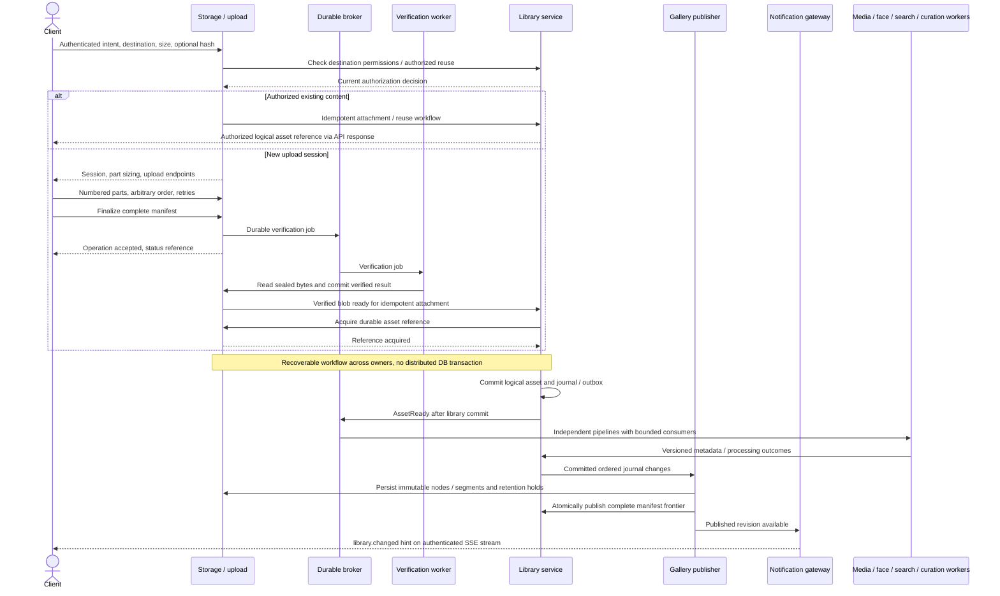
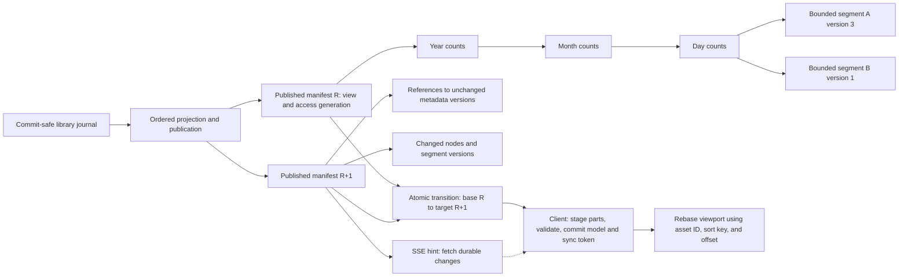
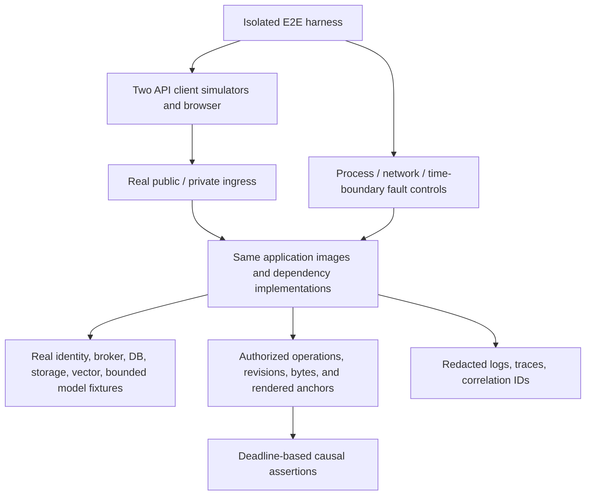

# System Architecture and Flows

## 1. Purpose and notation

This document illustrates the production north star in
[000 - Media platform](000-media-platform.md). Security analysis and proposed
additional controls are in [002 - Threat model](002-threat-model.md).

Boxes group ownership/trust boundaries, not machines. A home server can colocate
components; AKS or another cluster can distribute them. Databases, storage
engines, and network providers are configuration/adapters, not client contracts.
Arrows identify logical communication; they do not grant authorization.
Mobile behavior and unconfirmed UX recommendations are in
[003 - Native mobile client](003-mobile-client.md).

## 2. System and trust boundaries

```mermaid
flowchart TB
    subgraph callers["Untrusted client devices"]
        client["Web / native clients"]
        admin["Administrator browser"]
    end

    subgraph publicEdge["Public HTTPS boundary"]
        edge["Public gateway"]
        login["Public OIDC / enrollment endpoints"]
    end

    subgraph privateEdge["Authorized private network only"]
        privateGw["Private admin gateway"]
        console["Admin console / backend"]
        idAdmin["Identity management endpoints"]
    end

    subgraph pushEdge["Optional external OS push delivery"]
        push["APNs / Android provider or restricted relay"]
    end

    subgraph identity["Identity provider ownership"]
        idp["Auth server: OIDC and passkeys"]
        iddb[("Identity persistence")]
    end

    subgraph services["Private application network: authenticate service calls"]
        library["Library service: assets, grants, private reviews, journal, sync APIs"]
        upload["Storage / upload service: sessions, blobs, references, GC"]
        face["Face service: people and manual corrections"]
        search["Search service: generations and vector adapter"]
        curation["Curation service: cleanup assessments and scan generations"]
        publish["Library-owned gallery projection / publisher"]
        notify["Notification gateway: SSE / mobile push hints"]
        broker["Durable broker: pub/sub and work queues"]
        media["Media / verification workers"]
        faceWork["Face pipeline workers"]
        searchWork["Search pipeline workers"]
        curationWork["Curation pipeline workers"]
        infer["ML inference: bounded CPU / GPU capacity"]
    end

    subgraph persistence["Service-owned persistence and private storage"]
        libdb[("Library DB adapter: assets, grants, reviews, journal, publication state")]
        updb[("Upload DB adapter: sessions and references")]
        facedb[("Face DB adapter: observations and corrections")]
        searchdb[("Search persistence and vector DB adapter")]
        curationdb[("Curation DB adapter: assessments, models, scans")]
        blobAdapter["Storage adapters: volume / S3 / Azure Blob"]
        objects[("Originals, derivatives, retained gallery metadata")]
    end

    client -->|"HTTPS APIs and ranged media"| edge
    client -->|"OIDC / passkey ceremonies"| login
    admin -->|"Private network plus admin authentication"| privateGw
    privateGw --> console
    console -->|"Scoped provisioning"| idAdmin
    login --> idp
    idAdmin --> idp
    idp --> iddb
    console -->|"Management APIs, not direct DB writes"| library
    console --> upload
    console --> face
    console --> search
    console -->|"Scoped scan management"| curation
    edge --> library
    edge --> upload
    edge -->|"SSE connection"| notify
    notify -->|"Minimal coalesced hints"| push
    push -->|"Best-effort wake-up"| client
    library -->|"Authorized search"| search
    library -->|"Person resolution"| face
    library -->|"Scoped cleanup assessment queries"| curation
    curation -->|"Versioned assessments via owning API"| library
    library -->|"Acquire / release references"| upload
    library --> libdb
    upload --> updb
    face --> facedb
    search --> searchdb
    curation --> curationdb
    libdb -->|"Committed journal"| publish
    publish -->|"Commit published manifest frontier"| libdb
    publish -->|"Metadata objects and durable holds"| upload
    publish -->|"Only published revision hints"| notify
    notify -->|"Subscription authorization"| library
    library -->|"Outbox: committed AssetReady and changes"| broker
    upload -->|"Verification work and blob lifecycle events"| broker
    broker --> media
    broker --> faceWork
    broker --> searchWork
    broker --> curationWork
    faceWork --> face
    searchWork --> search
    curationWork --> curation
    faceWork --> infer
    searchWork --> infer
    curationWork --> infer
    search -->|"Bounded interactive inference scheduling"| infer
    media -->|"Scoped media reads / writes"| upload
    faceWork -->|"Scoped media reads"| upload
    searchWork -->|"Scoped media reads"| upload
    curationWork -->|"Scoped media reads"| upload
    upload --> blobAdapter
    blobAdapter --> objects
```

Only user-facing APIs, login, and SSE are routed publicly. No public route reaches
admin endpoints, databases, broker, provider management, or inference. The private
network is not an administrator role: identities and permissions remain required.
Login and identity management may be routes of the same identity provider; they
are separate exposure surfaces, not necessarily separate server installations.
Native clients use HTTPS catch-up after optional OS push hints; they do not
require an application-owned persistent connection. Push sending authority is
scoped to the configured app/build. Provider/relay failure never blocks core
backup, browsing, or synchronization during permitted client execution.

Each service owns its persistence. The library publisher is an internal library
component, not an independent service that writes another owner's database.
Broker connectivity is private and credentialed. Internal peer identity and
fine-grained authorization require the controls tracked in the threat model;
network placement alone is not sufficient.

Curation classifies potential cleanup candidates, not deletion commands. The
library owns private review decisions and checks current permissions before
exposing results. Only an explicit user-confirmed library command, with atomic
permission/protection checks, can move selected assets to recoverable trash.
Curation workers cannot delete assets or release references. Review changes use
private library projections and the existing durable sync contract; merely
flagging media never removes it from the ordinary gallery.

## 3. Upload, processing, and publication milestones

The asynchronous completion/status shape above makes queued verification
observable; exact API paths and failure-state enums belong in the upload
protocol specification. An upload verification event is not `AssetReady`.
Reusable blobs still require a committed logical asset or an explicitly
idempotent existing-asset result before downstream processing.

The sequence omits retries for readability, not correctness. Durable workflows,
reference holds, outboxes, and reconciliation must cover crashes between steps.
It does not imply the client keeps an HTTP request open during verification.

## 4. Versioned browsing and synchronization

Both photo and video counts are maintained at each calendar level. Day grouping
does not bound transfer size: exceptionally large days contain multiple bounded
segments. Copy-on-write snapshots share unchanged metadata; they do not copy the
original photos/videos. Manifest publication occurs only after all dependencies
are durable.

SSE event IDs are not synchronization tokens. Clients use HTTPS for snapshots,
segments, deltas, and media, with polling recovery when SSE is unavailable.
Mobile clients can use the same durable APIs without SSE; OS push carries only
optional wake-up hints, not a replacement event log or guaranteed worker lease.
History expiry triggers an explicit anchored reset. Every read enforces current
authorization; retaining a snapshot never retains a revoked grant.

## 5. End-to-end test boundary

R31 requires real E2E evidence, supplemented by unit/property/adapter tests.
Controlled doubles are useful for some fault tests, but do not replace scenarios
with the selected real identity provider, storage, broker, and model execution.
No external biometric hardware or real family photos are required in ordinary
CI fixtures.
