# System and UX state machines

These diagrams describe the current implementation, not every roadmap feature.
The system diagram shows deployed components (dashed arrows mark optional
services or unshipped native UI). Every UX flow is modeled as a finite state
machine (`stateDiagram-v2`) grounded in the actual code. See
[implementation scope](media-api.md).

## System

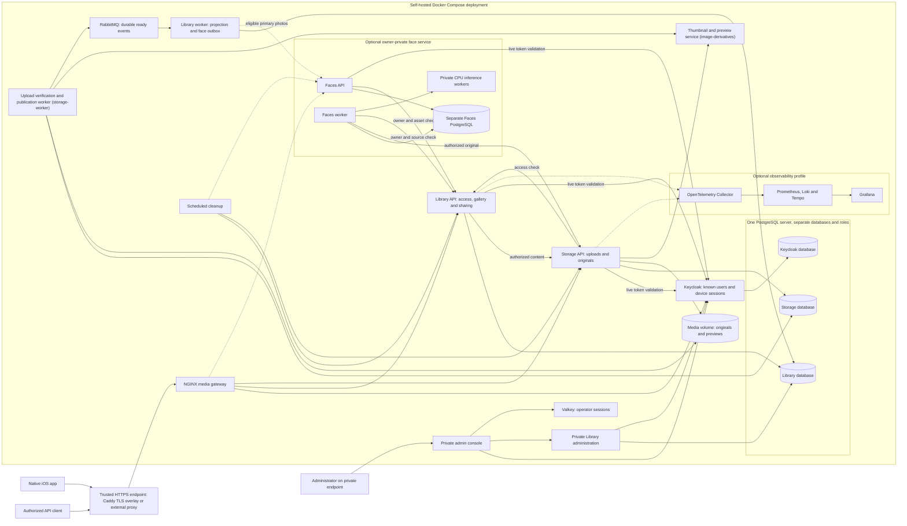

Public ingress never exposes internal APIs or administration. Media authority
comes from Library references, not a blob hash. Workers have durable database
outbox state; preview generation never modifies originals. Faces and monitoring
are independently optional. Books/cinema apps, semantic search and Kubernetes
deployment are future work, not hidden services in this diagram.

## 1. Admin provisioning and QR invitation state machines

### 1a. Durable administrative operations

Models `administration_operations` (`provision`, `profile`, and `access` commands)
in `PostgresAdministrationOperations.cs` and `AdministrationWorker.cs`.

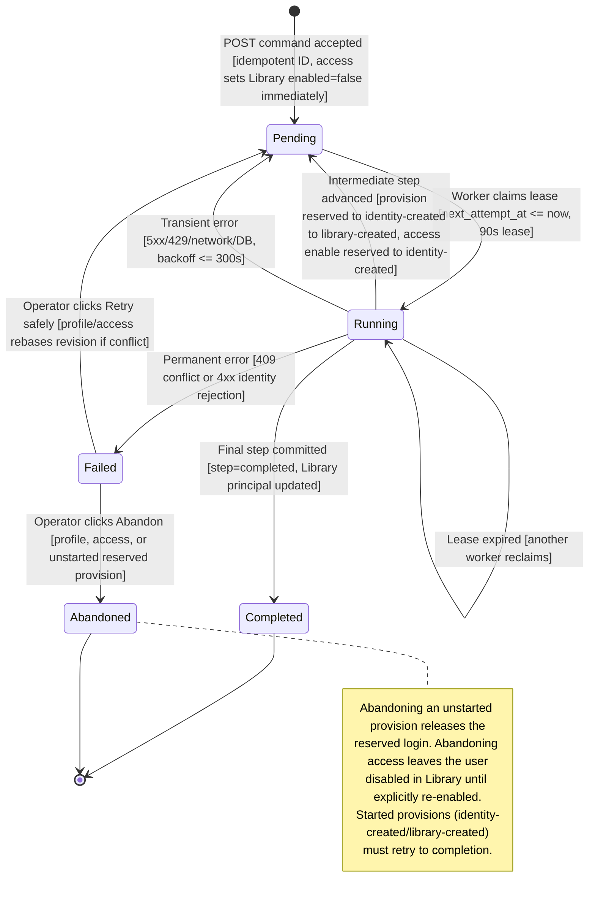

### 1b. Single-use QR invitation lifecycle

Models `EnrollmentResource.java`, `QrGrant.java`, `EnrollmentStore.java`, and
the admin console polling UI (`invitation.html` / `invitation.js`).

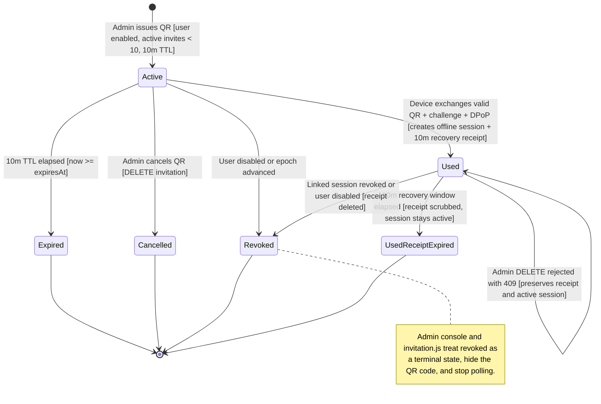

## 2. iOS enrollment and persistent session state machine

Models `SignInModel.Screen` (`SignInModel.swift`), `AppRootView.swift`,
`SignInView.swift`, `QREnrollmentClient.swift`, and `OAuthResponse.tokens`.

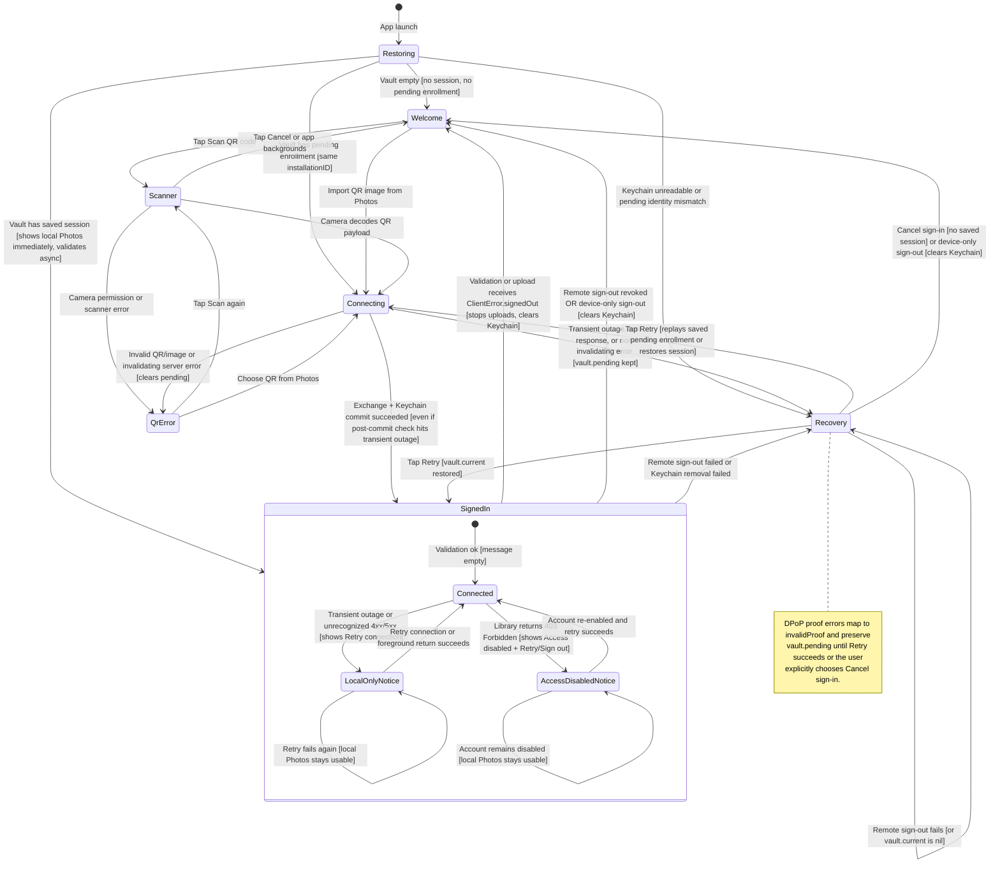

There is no public registration, manually entered upload URL, or per-renewal
biometric prompt.

## 3. Automatic backup and server upload state machines

### 3a. iOS upload item and growing batch

Models `UploadPhase` (`UploadPhase.swift`), `UploadCoordinator.swift`,
`SQLiteUploadRepository.swift`, `UploadModel.swift`, and `UploadsView.swift`.

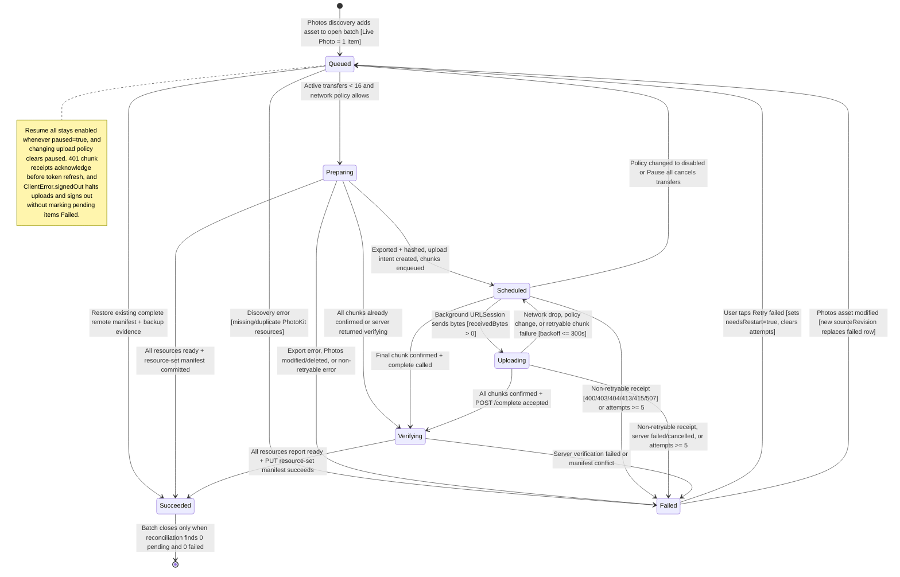

### 3b. Server upload resource and publication

Models `uploads.state` in `PostgresUploadRepository.cs`, `UploadWorker.cs`,
`ProjectionWorker.cs`, and `PostgresResourceSetRepository.cs`.

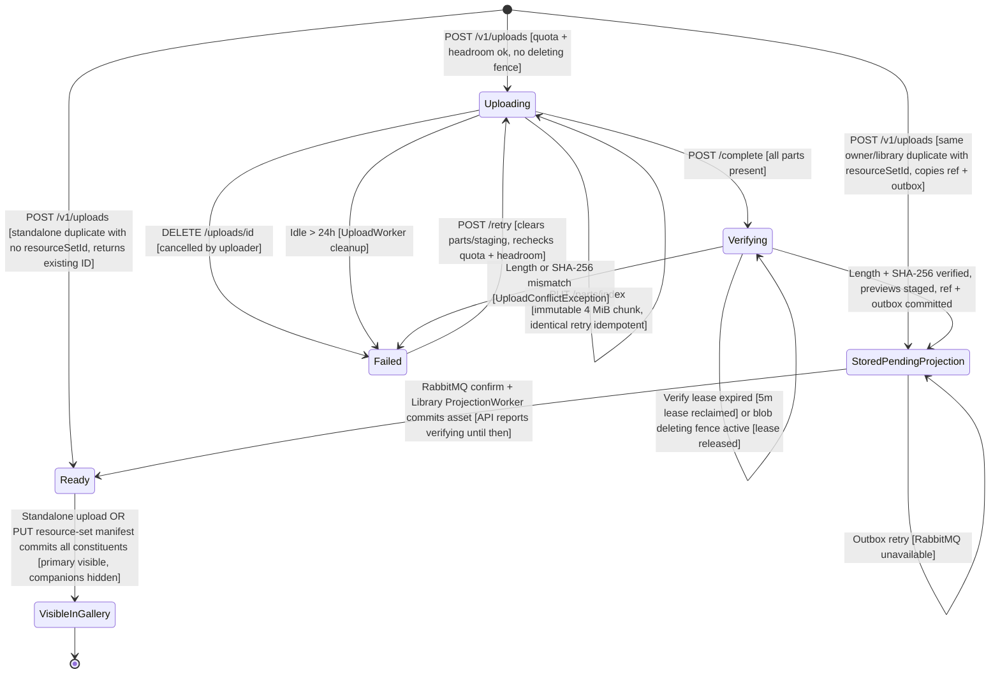

## 4. Local iOS gallery and media viewer state machine

Models `LocalMediaLibrary.swift`, `LocalGalleryView.swift`, and
`MediaViewer.swift`. Remote cloud browsing, People, Search and Shared filters
are not shipped in the iOS app.

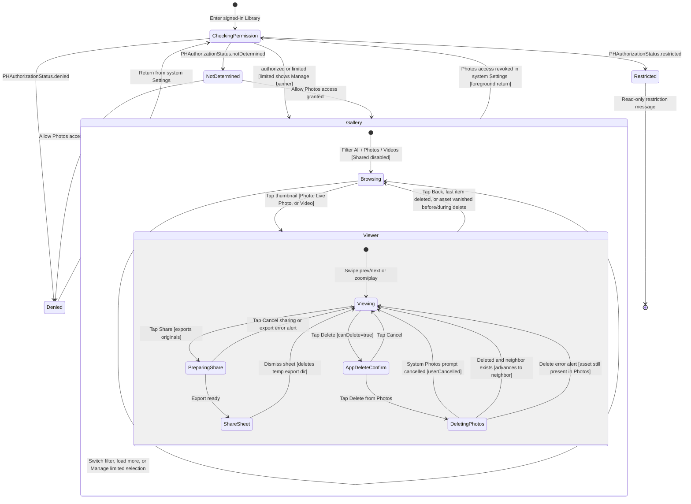

## 5. Server user-to-user sharing state machine

API is shipped (`SharingEndpoints.cs`, `PostgresSharingRepository.cs`,
`PostgresGalleryRepository.cs`); native iOS sharing UI is planned.

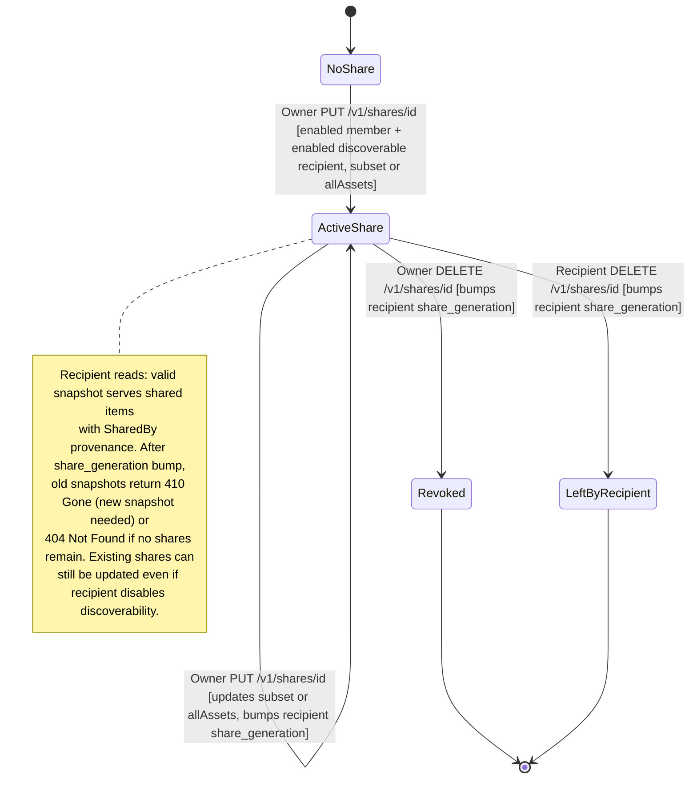

Native file sharing exports files through iOS Share Sheet and is independent of
server shares. Sharing media never shares the owner's private face labels.

## 6. Optional face analysis and person correction state machines

API and workers are shipped (`FaceEndpoints.cs`, `FaceWorker.cs`,
`PostgresFaceRepository.cs`); native People UI is planned.

### 6a. Face analysis job lifecycle

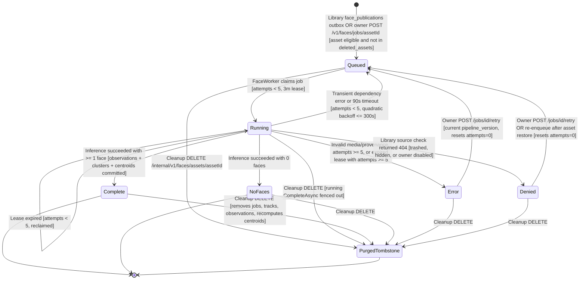

### 6b. Owner person and track correction states

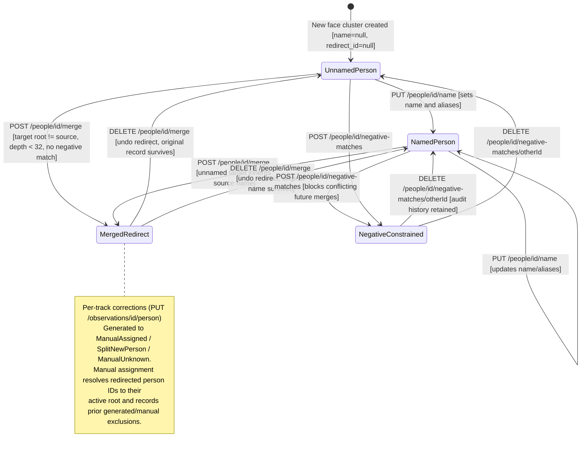

Merging people changes cluster redirects; it does not train the model.

## 7. Server deletion, trash retention and physical cleanup state machine

Models `PostgresAssetRepository.DeleteAsync`, `PostgresTrashRepository.cs`,
`CleanupJob.cs`, and `BlobCleanupRepository.cs`. The current iOS app only
exposes local Photos deletion, not server deletion or trash/restore UI.

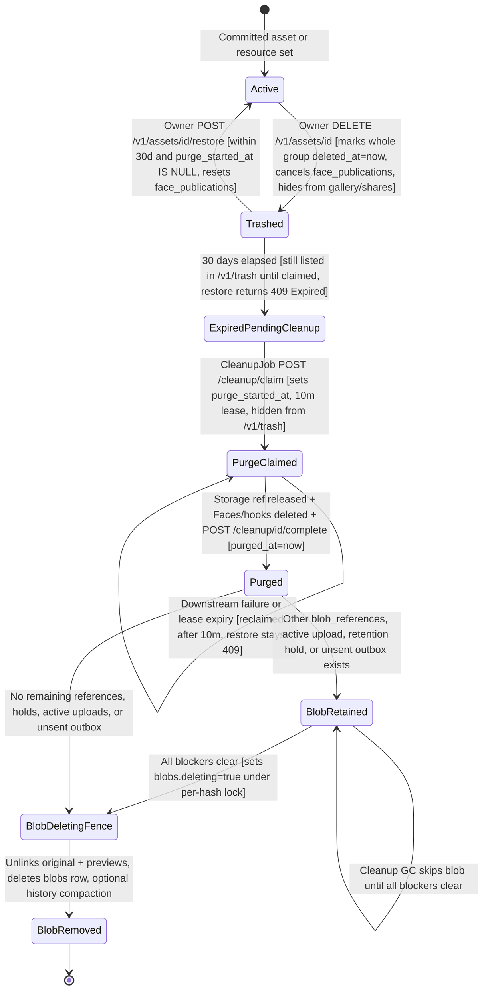

## 8. Private device revocation state machine

Models `scripts/admin_web.py` (`revoke_device`), `device-revoke.html`, and
`NephosAdminResource.java` (`revokeDevice`).

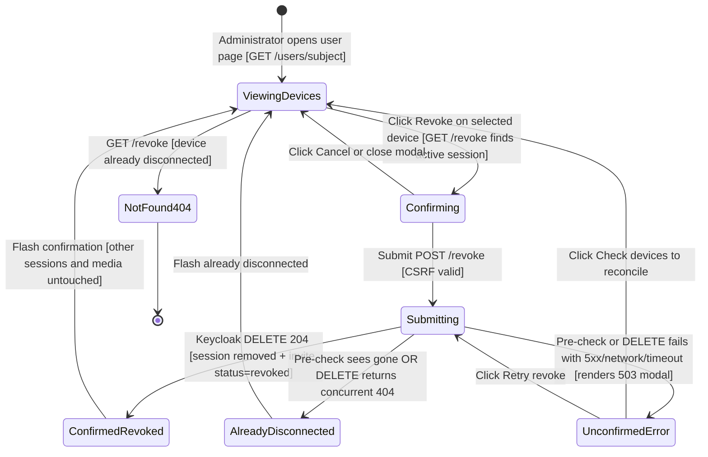

After `ConfirmedRevoked`, the revoked device returns to sign-in on its next
protected API validation or upload authorization check; other sessions and
stored media remain intact.

